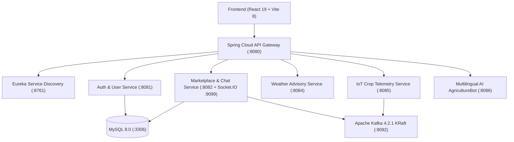

# 🌾 SmartKisan - Intelligent IoT Smart Agriculture & Marketplace Platform

[](https://react.dev/)
[](https://spring.io/projects/spring-boot)
[](https://kafka.apache.org/)
[](https://vitejs.dev/)
[](https://tailwindcss.com/)

**SmartKisan** is a modern, enterprise-grade, event-driven Smart Agriculture microservices ecosystem. It bridges physical IoT telemetry, smart irrigation automation, an agricultural e-commerce marketplace with real-time buyer-seller negotiation, and a multilingual multimodal AI crop advisor (English, Urdu, Sindhi).

---

## 🏗️ System Architecture



---

## ✨ Key Features

### 📡 1. Real-Time IoT Telemetry & Smart Irrigation
- **Simulated & Live Telemetry**: Streams real-time soil moisture, temperature, humidity, water level, light intensity, and barometric pressure.
- **Hardware Integration**: Ingests physical ESP32/Arduino data via `POST /api/iot/telemetry` and automatically switches between `SIMULATED` and `HARDWARE (LIVE)` modes.
- **Automated Irrigation**: Smart thresholds with manual/auto solenoid valve controls.

### 🛒 2. Agricultural Marketplace & Instant Buyer-Seller Chat
- **Farmer & Buyer Storefront**: Seeds, fertilizers, equipment, livestock, and crop produce.
- **Product Reviews & Ratings**: 5-star rating breakdown, verified buyer badges, and buyer feedback.
- **Instant Live Chat**: Direct messaging between buyers and sellers via Netty-SocketIO.
- **Price Bargaining**: Built-in counter-offer and price negotiation cards.

### 🤖 3. Multilingual & Multimodal AI AgricultureBot
- **Trilingual NLP**: Diagnostic advice in **English**, **Urdu (`اردو`)**, and **Sindhi (`سنڌي`)**.
- **Crop Disease Diagnosis**: Upload plant/leaf photos to receive instant symptoms, organic remedies, and chemical spray treatments.

### 🛡️ 4. Role-Based Access Control & Admin Panel
- **User Roles**: Farmer, Buyer, Seller, and SuperAdmin.
- **Admin Control Center**: User moderation, seller approvals, product listings verification, and system telemetry monitoring.

---

## 🚀 Quick Start Guide

### Prerequisites
- **Java 21 LTS**
- **Node.js 20+**
- **MySQL 8.0** (Port 3306)
- **Apache Kafka** (Included in project)

### 1. Start Kafka (KRaft Mode)
```cmd
start-kafka.bat
```

### 2. Start Microservices Stack
```cmd
start-all-spring-services.bat
```
*Or use the fast developer runner for instant zero-wait startup:*
```cmd
node backend/services-runner.js
```

### 3. Start Frontend
```cmd
cd frontend
npm install
npm run dev
```
Open **`http://localhost:3000`** in your browser.

---

## 🐳 Docker Deployment
To launch the entire platform in production containers:
```bash
docker compose up -d
```

---

## 📄 License
This project is licensed under the MIT License.
